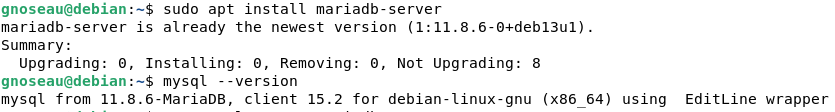
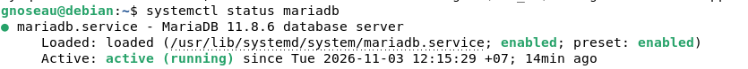
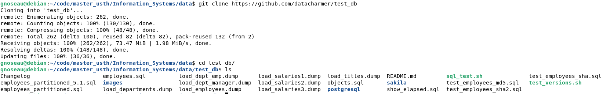
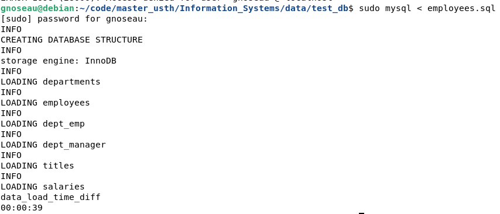
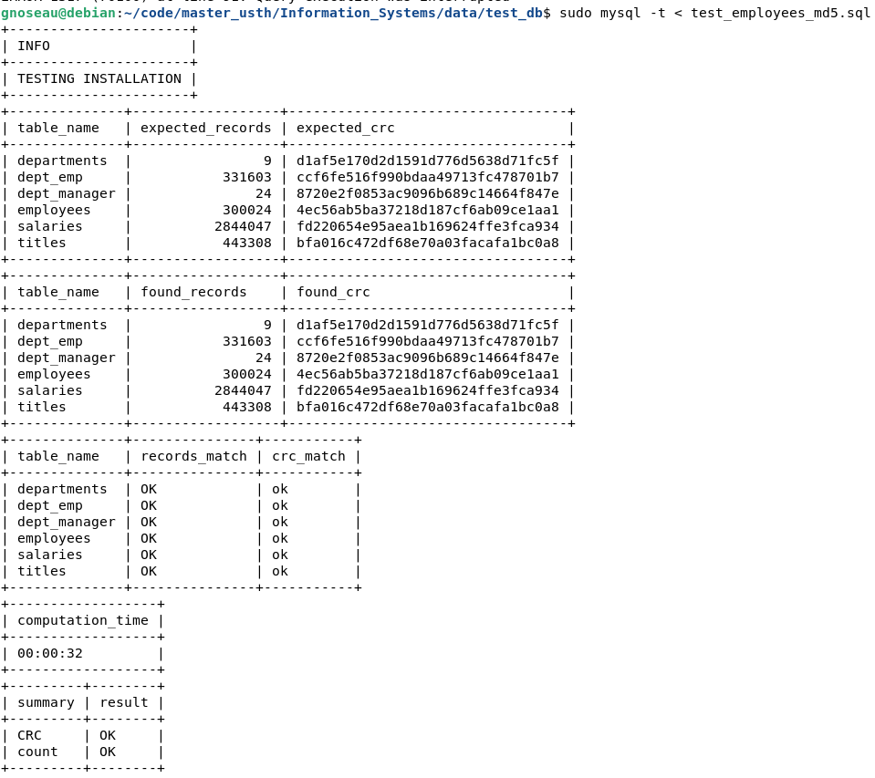

**Student Name**: Trịnh Quang Minh  
**Student ID**: 2640018

---

### 1. Objective 
Install MySQL (MariaDB), load the employees sample database from GitHub (datacharmer/test_db), and verify that the data is correct.

### 2. Steps  
**_2.1 Install MySQL (MariaDB)_**  

Commands:
```
sudo apt install mariadb-server   
mysql --version  
systemctl status mariadb            
```

Output:  



**_2.2 Clone the employees database_**  

Commands:
```
git clone https://github.com/datacharmer/test_db
cd test_db
ls
```

Output:  


**_2.3 Load the database_**  

Commands:
```
sudo mysql < employees.sql
```

Output:  


**_2.4 Verify the data_**  

Commands:
```
sudo mysql -t < test_employees_md5.sql
```

Output:  

